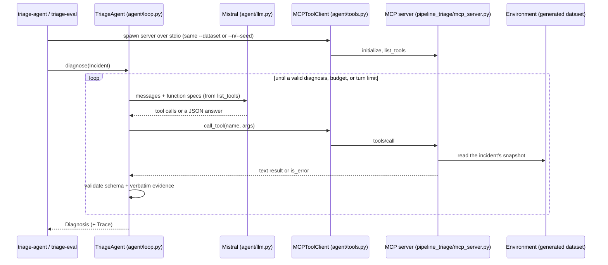

# Architecture

This document explains how the triage agent is put together and why. The
[README](README.md) covers what it does and how to run it.

## Components and data flow

| Module | Responsibility |
|---|---|
| `pipeline_triage/generator/` | Seeded synthetic incidents: per-cause builders, noise, ambiguity, run history, change history, schemas |
| `pipeline_triage/env.py` | In-memory dataset keyed by `run_id`; JSONL save/load |
| `pipeline_triage/mcp_server.py` | The four read-only tools as plain functions, plus `create_server()` registering them with schemas and descriptions |
| `pipeline_triage/mcp_server_main.py` | stdio entry point (`triage-mcp`) |
| `agent/tools.py` | `MCPToolClient`: a synchronous facade over an MCP `ClientSession` (stdio or in-memory) |
| `agent/loop.py` | The tool-calling loop, guardrails, repair turns, fallback, `Trace` |
| `agent/llm.py` | `LLMClient` protocol and the Mistral implementation (retries, `tool_choice`, chunked content) |
| `agent/schemas.py` | `Incident` (input) and `Diagnosis` / `EvidenceItem` (output) |
| `pipeline_triage/baseline/` | Rule-based keyword/regex classifier that calls the same tool functions directly |
| `pipeline_triage/eval/` | Harness (metrics, confusion, calibration, operational means, per-run predictions) and the `triage-eval` CLI |

## Key design decisions

### Every tool is scoped to the incident under investigation

Each generated incident is an **independent snapshot of a world**: its own table
schemas, change history and run history. So every tool takes `run_id` and answers
from that incident's snapshot, with time windows anchored at the run's start:

- `get_recent_changes(run_id, since_hours)`: changes in `[start - since_hours, start]`
- `get_table_schema(run_id, table)`: the schema as of the run's start
- `get_run_history(run_id, last_n)`: the pipeline's recent runs, ending with this one

An earlier version queried by pipeline or table across all incidents, which mixed
unrelated worlds. Only 2 of 14 schema-drift incidents saw their own drifted schema,
and only 1 of 13 bad deploys saw its culprit commit. `tests/test_mcp_server.py`
asserts that no tool leaks another incident's evidence.

### The agent only reaches tools through MCP

`MCPToolClient` lists the server's tools and converts them into function-calling
specs, so tool names, descriptions and parameter bounds live in exactly one place
(`create_server`). The CLI and eval spawn the real server over stdio, while tests use
the SDK's in-memory transport, which exercises the same protocol path without a
subprocess.

The MCP SDK is async, and its transports use anyio cancel scopes that must be
entered and exited by the same task. The client therefore runs the session as one
long-lived task on a private event loop in a background thread, and the synchronous
agent loop submits calls with `run_coroutine_threadsafe`.

The stdio server gets the SDK's minimal default environment plus `PYTHONPATH`, so
API keys are never passed to the tool process.

Deliberate tool errors raise a subclass of the SDK's `ToolError`, so their message
reaches the model as an `is_error` result. Any other exception is treated by the SDK
as a crash, and the model only sees a generic "Error executing tool".

### Guardrails

| Guardrail | Where |
|---|---|
| Tools are read-only (`readOnlyHint`), and there is no write tool | `create_server` |
| Tool-call budget per incident (12). When it runs out, remaining calls get an error result and the model must answer with what it has | `TriageAgent.diagnose` |
| Turn limit (10) and repair limit (2) | `TriageAgent.diagnose` |
| `requires_human_approval` is forced to `true` | `Diagnosis` validator |
| Every evidence quote must appear verbatim in a successful output of the tool its `source` names | `TriageAgent._check_evidence` |
| A real cause needs at least one evidence item, while `unknown` may cite none | `Diagnosis` validator |
| The model cannot change the incident's `run_id` | `_parse_diagnosis` |
| Fallback is `unknown`, confidence 0, citing the last ERROR log line verbatim | `_fallback_diagnosis` |

Answer-only turns (after a rejected answer or an exhausted budget) keep the tool
specs but send `tool_choice="none"` with JSON mode, which keeps the tool-call history
valid for the API. Every fallback records why it happened (`tool_budget_exceeded`,
`invalid_output` or `max_turns_exceeded`), and `Trace.rejections` records each
rejected answer for debugging.

### Synthetic data that does not give the answer away

- **Determinism.** Seeds plus UTC timestamps mean a given `(n, seed)` produces
  byte-identical data on every machine (tested across timezones). The stdio server
  and the client generate the same dataset independently.
- **Realistic logs.** Each failing task's log starts with a "started" line,
  followed by every signal line of the cause, plus routine noise inserted in
  chronological order.
- **Red herrings.** About a third of incidents get one benign line that uses
  another category's vocabulary ("optional metrics push returned 403", "Partition not
  found in local cache"). A careful reader ignores them, but a keyword matcher does not.
- **Genuine ambiguity.** For the pairs in `AMBIGUOUS_PAIRS` (schema_drift ↔
  bad_deploy, transient_infra ↔ upstream_dependency_failure), an ambiguous incident
  contains both causes' evidence (for example, a schema change *and* a meaningful
  deploy), and either label is accepted.
- **No label hints.** No log line names the cause or hints at it.

### Evaluation

`evaluate(env, predictor, run_ids=None)` scores any `run_id -> {root_cause,
confidence, ...}` function. It reports accuracy, macro-F1, per-class P/R/F1, a
confusion matrix (truth × prediction) and calibration buckets. When the predictor
reports `tool_calls`, `prompt_tokens`, `completion_tokens`, `wall_time_s` or
`fallback`, the harness also gives their means per run. Per-run predictions are kept
in the report for error analysis. `--limit N` picks a deterministic, class-stratified
subset, so agent runs stay affordable.

## Extending

- **New failure cause:** add a builder in `generator/builders.py`, register it in
  `BUILDERS`, add the label to `RootCause` and the system prompt taxonomy, and
  optionally pair it in `AMBIGUOUS_PAIRS`.
- **New tool:** add a plain function in `mcp_server.py` (scoped by `run_id`, raise
  `ToolError` for user-facing errors), register it in `create_server` with an
  annotated signature, and add its evidence source to `SOURCE_TOOL` in
  `agent/schemas.py`. The agent picks it up via `list_tools`.
- **Different LLM:** implement the `LLMClient` protocol in `agent/llm.py` (one `chat`
  method returning `LLMResponse`).
