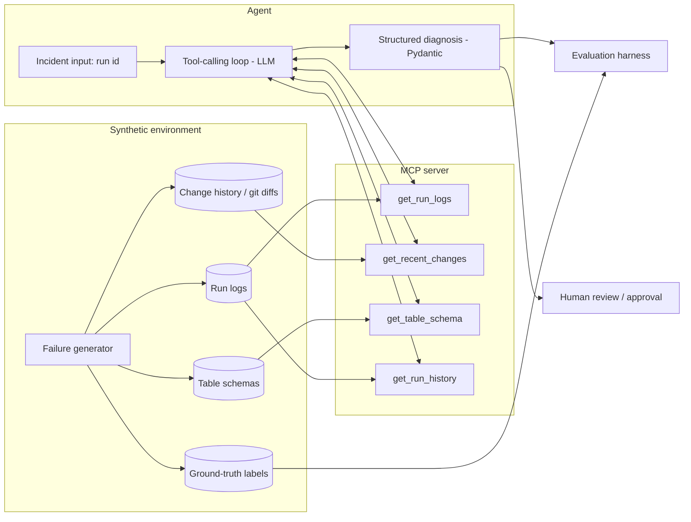

# Project 2: Data-Pipeline Failure Triage Agent (with MCP)

> Repo: `github.com/olehkuzin/pipeline-triage-agent` (rename as you like)

## 1. Idea

An AI agent that reads failed data-pipeline runs (logs, error messages, recent code/config changes, table schemas), **classifies the likely root cause**, and **proposes the next step**. It never changes anything on its own: it only recommends, and a human approves.

This project combines your data engineering experience with agentic AI. Its value is that the failure scenarios are realistic, because you know how pipelines actually break.

### Data
Use **synthetic and public data only**. Build a small generator that produces failed runs for a fake orchestrated pipeline (Airflow-style task logs), each with a ground-truth label.

### Failure taxonomy (starting point)

| Label | Example signal |
|---|---|
| `schema_drift` | Column missing/renamed/type changed upstream |
| `late_or_missing_data` | Source file or partition not arrived, sensor timeout |
| `resource_exhaustion` | OOM, disk full, executor lost |
| `permission_or_auth` | Expired credential, access denied |
| `bad_deploy` | Failure begins right after a code/config change |
| `data_quality_violation` | Null/duplicate/range check failed |
| `upstream_dependency_failure` | A parent task failed, this one is a symptom |
| `transient_infra` | Network timeout, throttling, retry succeeds |
| `unknown` | Not enough evidence (the agent should be allowed to say this) |

## 2. Architecture



### Components

| Component | Responsibility |
|---|---|
| **Failure generator** | Produces N failed runs per category with realistic logs, noise, and ambiguous cases. Seeded for reproducibility. |
| **MCP server** | Exposes read-only tools over the synthetic environment. The agent consumes them through the MCP client interface. |
| **Agent loop** | LLM decides which tools to call, gathers evidence, then returns a structured diagnosis. |
| **Output schema** | Pydantic model: `root_cause`, `confidence`, `evidence[]`, `proposed_next_step`, `requires_human_approval`. |
| **Guardrails** | Read-only tools; max tool-call budget per incident; the agent can only propose actions, never execute them. |
| **Baseline classifier** | Keyword/regex rule-based classifier to benchmark the LLM against. |
| **Evaluation harness** | Runs all test cases, computes accuracy, per-class precision/recall, confusion matrix, cost and latency. |

### MCP tool definitions (sketch)

```
get_run_logs(run_id: str, tail_lines: int = 200) -> str
get_recent_changes(pipeline: str, since_hours: int = 48) -> list[Change]
get_table_schema(table: str, as_of: datetime | None) -> Schema
get_run_history(pipeline: str, last_n: int = 10) -> list[RunSummary]
```

All tools are **read-only**. Optionally, add a `propose_action` tool that only writes a recommendation record, not a real change.

### Output schema sketch

```json
{
  "run_id": "string",
  "root_cause": "schema_drift",
  "confidence": 0.82,
  "evidence": [
    "Log line 143: column 'customer_id' not found in source table",
    "Schema changed 3h before the failing run"
  ],
  "proposed_next_step": "Update mapping for renamed column and re-run from task X",
  "requires_human_approval": true
}
```

## 3. Stack

| Layer | Choice | Notes |
|---|---|---|
| Language | Python 3.12 | |
| LLM | Anthropic Claude via the official SDK | Tool use + structured output |
| Tool protocol | MCP (official Python SDK) | Server exposes tools, agent connects as client |
| Agent framework | Plain tool-calling loop first; LangGraph optional | Plain code is easier to explain and debug in interviews |
| Validation | Pydantic | Enforce the output schema, retry on invalid output |
| Synthetic data | Python generator + Faker | Seeded, with ground-truth labels |
| Evaluation | Custom harness, scikit-learn metrics | Confusion matrix, per-class precision/recall |
| Observability | Langfuse or structured JSON logs | Trace tool calls per incident |
| Testing | pytest | Unit-test the MCP tools and generator; mock the LLM in agent tests |
| Containers | Docker | One image for the MCP server, one for the agent |
| CI | GitHub Actions | Lint, tests, and a small eval run on a subset (with a mocked or cached LLM) |

## 4. Evaluation plan

**Test set:** 100+ synthetic failed runs, balanced across categories, with:
- ~15% ambiguous cases (multiple plausible causes)
- ~10% cases where the correct answer is `unknown`
- Noisy logs (irrelevant warnings, long stack traces)

**Metrics**
- Overall accuracy and macro-F1
- Per-class precision and recall
- Confusion matrix (which categories get mixed up, and why)
- Evidence quality: does the cited evidence actually appear in the logs (spot-check or automated string match)
- Calibration: is higher confidence correlated with correctness
- Cost and latency per incident, average tool calls per incident

**Comparisons to report**

| Variant | Purpose |
|---|---|
| Rule-based baseline | Shows what the LLM adds |
| LLM, single prompt, logs only | Simple approach |
| LLM agent with tools (MCP) | Full system |
| Agent + prompt improvements | Error-driven iteration based on the confusion matrix |

Resume bullet example: "Agent classified failure root cause with X% accuracy on N synthetic cases (vs. Y% for a rule-based baseline) using an MCP server exposing read-only pipeline tools."

## 5. Repository layout

```
pipeline-triage-agent/
├── generator/          # synthetic failure generator + labels
├── mcp_server/         # MCP tools over the synthetic environment
├── agent/
│   ├── loop.py         # tool-calling loop
│   ├── schemas.py      # Pydantic output models
│   └── prompts.py
├── baseline/           # rule-based classifier
├── eval/
│   ├── run_eval.py
│   └── reports/
├── tests/
├── Dockerfile
├── docker-compose.yml
├── .github/workflows/ci.yml
└── README.md
```

## 6. Milestones

1. **Generator**: produce failed runs with ground-truth labels across all categories.
2. **MCP server**: implement the four read-only tools, test them.
3. **Baseline**: rule-based classifier plus evaluation harness, record baseline accuracy.
4. **Agent v1**: tool-calling loop with structured output.
5. **Iterate**: analyze the confusion matrix, improve prompts and tools, rerun the eval.
6. **Guardrails and observability**: tool-call budget, approval flag, tracing.
7. **Docker + CI**, then README with architecture, results, and limitations.

## 7. README must-haves
- The problem in two sentences (why failure triage is slow and manual)
- Architecture diagram and failure taxonomy
- Results table: baseline vs. LLM vs. agent, plus confusion matrix image
- Clear statement: "synthetic data only; agent is advisory and read-only"
- Limitations (synthetic logs are cleaner than real ones) and next steps

## 8. Stretch goals (only if time allows)
- Add a `propose_action` flow with an explicit approval step
- Test on public real-world logs (e.g. open Loghub datasets) for a small realism check
- Slack or webhook notification with the diagnosis
- Cache tool results to cut cost during evaluation runs
